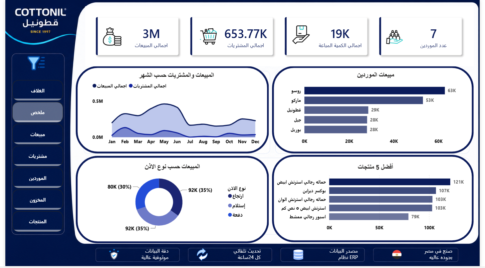

# Cottonil Business Intelligence Dashboard

An Arabic-language Power BI dashboard that brings sales, purchasing, inventory, supplier accounts, and product performance into one report. Built by **Reem Ashraf and Sally Louis**.

## Business questions

- Which products drive sales by revenue and units sold?
- How do sales and purchases change over time?
- Which suppliers account for the largest purchase volumes or outstanding balances?
- Which categories hold the most stock, and which items should be reviewed before reordering?

## Power BI preview

| Report page | Preview |
| --- | --- |
| Cover | [Open](01-cover.png) |
| Overview | [Open](02-overview.png) |
| Sales | [Open](03-sales.png) |
| Purchases | [Open](04-purchases.png) |
| Suppliers | [Open](05-suppliers.png) |
| Inventory | [Open](06-inventory.png) |
| Products | [Open](07-products.png) |

## Project files

- Power BI report: Cottonil-Dashboard.pbix
- Excel workbooks for sales, purchases, inventory counts, and supplier accounts
- [Analysis report](Cottonil-Analysis-Report.pdf)

Open the PBIX in Power BI Desktop. If refresh reports missing files, open **File → Options and settings → Data source settings** and point the file connections to the corresponding workbooks. Some workbooks have both source and cleaned versions.

The previews are the original Power BI captures embedded in the project report.
